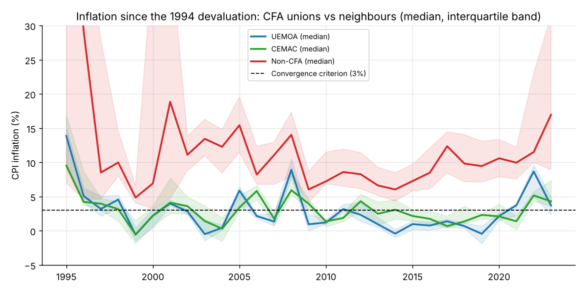
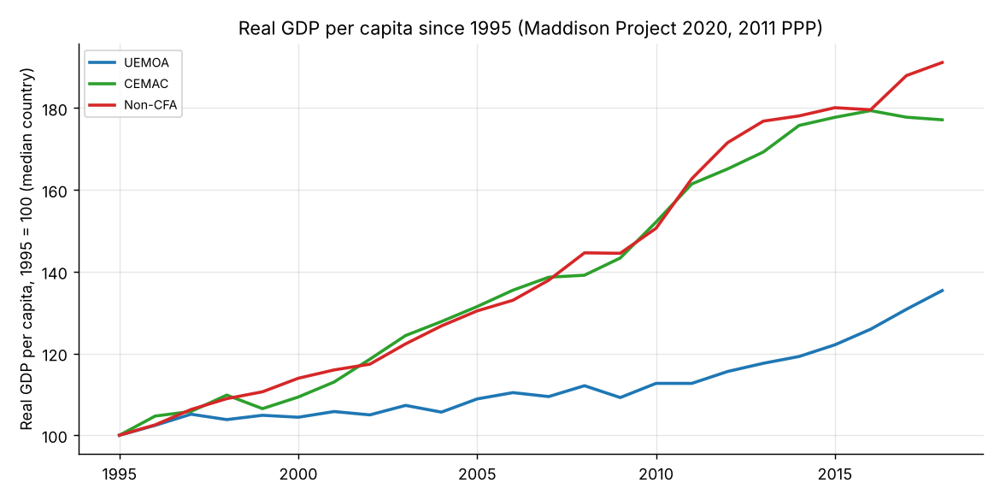
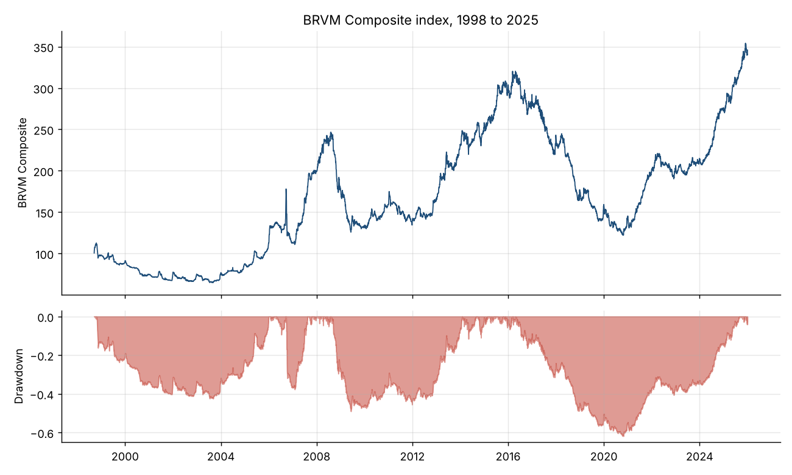
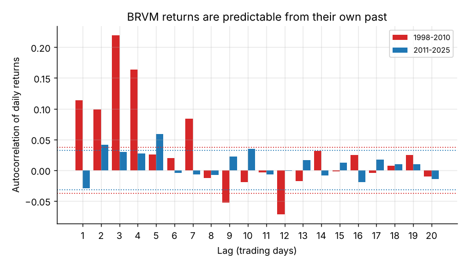

# CFA Franc Zones and the BRVM: Macro Stability and Market Behaviour

Two questions about the West and Central African franc zones:

1. **Does belonging to a CFA monetary union (UEMOA / BCEAO, CEMAC / BEAC) buy price stability, and
   at what cost in growth?** 14 CFA countries are compared with 8 neighbours that run their own
   currency, from the 1994 devaluation to 2023.
2. **How does the regional stock exchange (BRVM) behave?** Returns, risk, crashes and weak-form
   efficiency of the BRVM Composite from 1998 to 2025.

## Part 1. Monetary union and macroeconomic performance

**Groups.** UEMOA: Benin, Burkina Faso, Côte d'Ivoire, Guinea-Bissau, Mali, Niger, Senegal, Togo.
CEMAC: Cameroon, Central African Republic, Chad, Congo, Equatorial Guinea, Gabon.
Non-CFA: Nigeria, Ghana, Guinea, Sierra Leone, Gambia, Liberia, Mauritania, DR Congo.

### Inflation, 1995 to 2023 (World Bank CPI)

| | UEMOA | CEMAC | Non-CFA |
|---|---|---|---|
| Median inflation | **2.1%** | **2.9%** | 9.8% |
| Mean inflation | 3.3% | 3.4% | 23.8% |
| Country-years within the 3% convergence criterion | **65%** | **51%** | 8% |
| Country-years above 10% | 5% | 5% | 47% |
| Volatility of inflation (median country, pp) | 3.5 | 3.3 | 9.4 |
| Median inflation in the 2022 shock | 8.7% | 5.2% | 11.5% |

Panel regression of inflation on a CFA dummy with **year fixed effects** (common shocks such as oil
or food prices absorbed), errors clustered by country, inflation winsorised at 1%/99%:

| Specification | Effect on inflation | Clustered SE | p-value |
|---|---|---|---|
| CFA membership | **-11.0 pp** | 2.9 | < 0.001 |
| UEMOA | -11.1 pp | 3.0 | < 0.001 |
| CEMAC | -10.9 pp | 2.9 | < 0.001 |
| Median regression, CFA | -7.4 pp | 0.3 | < 0.001 |



**Reading.** The fixed peg to the euro and the monetary discipline of the two central banks deliver
inflation 7 to 11 points lower than in comparable neighbours, with a third of the volatility. Both
unions behave almost identically. Even during the 2022 imported-inflation shock, CFA countries stayed
well below neighbours like Ghana (31%) or Nigeria (19%).

### Growth, 1995 to 2018 (Maddison Project, real GDP per capita)

| | UEMOA | CEMAC | Non-CFA |
|---|---|---|---|
| Mean annual growth per capita | 1.3% | 3.2% | 2.5% |
| Median cumulative growth 1995 to 2018 | +35% | +77% | +91% |
| Growth volatility (median country, pp) | 2.7 | 6.3 | 4.3 |

With year fixed effects, the CFA growth gap is **-0.6 pp per year and not statistically significant**
(p = 0.28). CEMAC growth is high but extremely volatile because it rides the oil cycle (Equatorial
Guinea, Congo, Gabon, Chad). UEMOA grew slowly but steadily; its weak average reflects country
crises (Côte d'Ivoire 1999 to 2011, Guinea-Bissau, Mali) more than the currency regime.



**Takeaway:** the CFA arrangement clearly buys price stability; the evidence that it costs growth
is weak in this sample. This is a descriptive comparison, not a causal estimate: union membership is
historical, not random.

## Part 2. The BRVM Composite, 1998 to 2025

| Period | Annualised return | Volatility | Max drawdown | Zero-return days |
|---|---|---|---|---|
| Full sample 1998 to 2025 | 4.8% | 12.4% | -62% | 2.8% |
| 1998 to 2005 | 1.9% | 10.1% | -42% | 8.1% |
| 2006 to 2015 (boom) | 10.1% | 14.7% | -49% | 2.1% |
| 2016 to 2020 (bear market) | **-15.0%** | 12.6% | **-62%** | 0.2% |
| 2021 to 2025 (recovery) | **17.5%** | 9.1% | -14% | 0.3% |

(Log returns of the price index, dividends excluded.)

- **Boom and bust:** +77% in 2007 and +39% in 2013, then five straight negative years (2016 to 2020)
  that erased 62% of the index, before a strong recovery (+39% in 2021, +29% in 2024, +25% in 2025).
- **Extreme tails:** daily excess kurtosis of 17, far above developed markets.



### Is the BRVM weak-form efficient?

| Sample | AR(1) | VR(5) | VR(10) | VR(20) |
|---|---|---|---|---|
| 1998 to 2010 | **0.11** | **1.53** (p < 0.001) | **1.93** (p < 0.001) | **2.06** (p < 0.001) |
| 2011 to 2025 | -0.03 | 1.04 (p = 0.45) | 1.13 (p = 0.08) | 1.24 (p = 0.02) |

Lo-MacKinlay variance ratios equal 1 under a random walk. Before 2011, ratios of 1.5 to 2 and strong
positive autocorrelation show that **past returns predicted future returns**: a sign of thin trading
and stale prices (8% of days with an unchanged index in 1998 to 2005). Since 2011 the market is much
closer to a random walk, consistent with deeper liquidity, although some long-horizon momentum remains.



## Data

| File | Source |
|---|---|
| `data/cpi_inflation_world_bank.csv` | World Bank, inflation, consumer prices (annual %), via the [datasets/inflation](https://github.com/datasets/inflation) package |
| `data/maddison_2020.csv` | Maddison Project Database 2020 (Bolt and van Zanden), via [Our World in Data](https://github.com/owid/owid-datasets) |
| `data/brvm_composite_daily.csv` | BRVM Composite daily closes, community-maintained [brvm-data](https://github.com/balletyanick/brvm-data) |

Data note: in the `datasets/inflation` package the two files are mislabelled (the file named
"consumer" holds the GDP deflator and vice versa). This was detected by checking values against
published CPI figures (e.g. Gabon 2022: 4.2% CPI vs 14.8% deflator) and the correct series is used here.

## Run it

```bash
pip install -r requirements.txt
python run_analysis.py      # a few seconds; writes results/ and figures/
```

**Author:** Klaus KUEKOU
